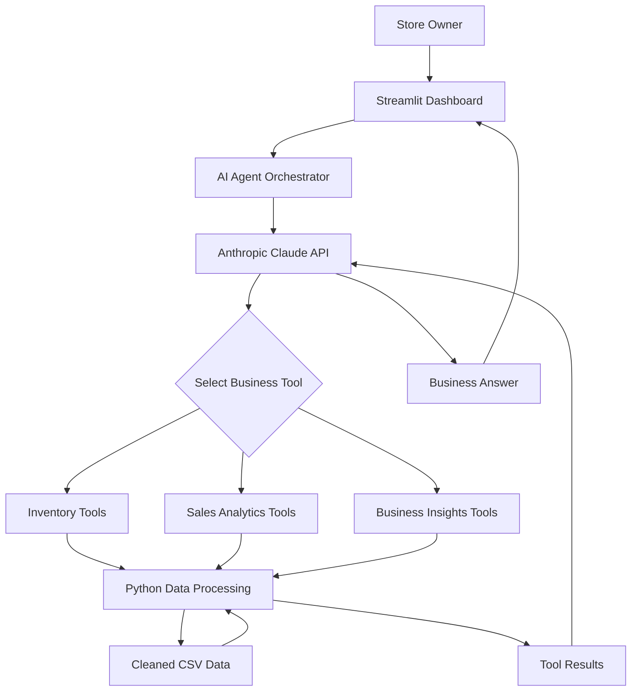

# FashionIQ AI — Intelligent Fashion Business Assistant

**An AI-powered business intelligence assistant for ethnic-wear retail businesses.**

FashionIQ helps retail store owners make smarter operational decisions using inventory analytics, sales intelligence, business recommendations, and natural-language interaction powered by Anthropic Claude.

The application analyses data from two retail branches and allows users to ask business questions in natural language. Claude selects the appropriate Python tools, executes them against the cleaned business datasets, and presents evidence-based answers.

---

## Key Features

### AI Business Assistant
- Natural-language business queries using Claude.
- Anthropic tool calling for dynamic Python function execution.
- Multiple tool calls when a question requires combined analysis.
- Conversation history within the application.
- Visible agent activity, tool inputs, and execution results.
- Explicit handling of unknown products and missing data.

### Inventory Management
- View inventory across both branches.
- Filter inventory by branch.
- Identify low-stock products.
- Generate branch-wise reorder recommendations.
- Search products by category and price.
- Summarise total stock and inventory value.

### Sales Analytics
- Calculate revenue over a selected period.
- Identify best-selling products.
- Analyse category-wise performance.
- Compare sales between branches.
- Identify slow-moving products.
- Analyse units sold, transactions, and revenue.

### Business Intelligence
- Identify inventory requiring replenishment.
- Calculate capital tied up in slow-moving inventory.
- Compare branch performance.
- Generate rule-based operational recommendations.

### Interactive Dashboard
- Multi-page Streamlit interface.
- Interactive Plotly charts.
- Business performance metrics.
- Inventory health visualisations.
- AI assistant with expandable tool execution details.

---

## Technology Stack

| Component | Technology |
|---|---|
| Programming Language | Python |
| AI Model | Anthropic Claude Haiku 5.5 |
| AI Integration | Anthropic Python SDK |
| Backend Analytics | Pandas |
| Frontend | Streamlit |
| Visualisation | Plotly |
| Data Storage | CSV |
| Environment Management | Python Virtual Environment, python-dotenv |
| Testing | pytest |

---

## System Architecture



### AI Agent Workflow

1. The user submits a business question through the Streamlit interface.
2. The orchestrator sends the question and available tool definitions to Claude.
3. Claude determines which business tools are required.
4. The Python application executes the selected functions.
5. Tool results are returned to Claude.
6. Claude generates a response based on the retrieved results.
7. The application displays the answer and the tools executed.

The application uses actual Python function execution rather than hardcoded responses to predefined questions.

---

## Project Structure

```text
fashioniq-ai/
│
├── agents/
│   ├── __init__.py
│   ├── data_loader.py
│   ├── orchestrator.py
│   ├── prompts.py
│   └── tool_registry.py
│
├── assets/
│
├── data/
│   ├── inventory.csv
│   └── sales.csv
│
├── tests/
│   ├── test_business_insights.py
│   ├── test_data_cleaning.py
│   ├── test_inventory.py
│   └── test_sales.py
│
├── tools/
│   ├── __init__.py
│   ├── business_insights.py
│   ├── inventory_tools.py
│   └── sales_tools.py
│
├── utils/
│   ├── __init__.py
│   └── data_cleaning.py
│
├── .env.example
├── .gitignore
├── app.py
├── config.py
├── requirements.txt
└── README.md
```

*Note: Keep this tree aligned with the actual files in the repository.*

---

## Installation and Setup

### 1. Clone the repository

```bash
git clone https://github.com/karimulla135/fashioniq-ai.git
cd fashioniq-ai
```

### 2. Create a virtual environment

```bash
python -m venv .venv
```

Activate it:

**Windows PowerShell**

```powershell
.\.venv\Scripts\Activate.ps1
```

### 3. Install dependencies

```bash
pip install -r requirements.txt
```

### 4. Configure the Anthropic API key

Create a `.env` file in the project root:

```env
ANTHROPIC_API_KEY=your_anthropic_api_key
CLAUDE_MODEL=claude-haiku-5-5
```

Never commit `.env` or expose your API key publicly.

### 5. Run the application

```bash
streamlit run app.py
```

Open the local URL displayed in your terminal.

---

## Dataset and Data Cleaning

FashionIQ uses two CSV datasets:

- `inventory.csv` — product details, branch information, stock quantities, prices, and reorder levels.
- `sales.csv` — transactions, dates, product IDs, quantities, prices, discounts, and payment information.

The datasets contain inconsistencies that require preprocessing before analysis.

### Data preparation

The data-cleaning layer handles:

- Mixed price formats.
- Inconsistent stock quantity formats.
- Mixed date formats.
- Missing inventory quantities.
- Missing transaction prices.
- Inconsistent category names and product identifiers.
- Product IDs appearing in sales but missing from inventory.
- Returns and negative transaction quantities.

### Data quality considerations

- Missing stock quantities are not automatically treated as zero.
- Missing sales prices are recovered from the inventory catalogue where possible.
- Unresolved product records are identified rather than silently assigned invented values.
- Returns are handled through the existing sales-cleaning and analytics logic.
- Unknown stock values are excluded from known inventory-capital totals.

These decisions help preserve data accuracy and avoid misleading business recommendations.

---

## Assessment Business Questions

The assistant is designed to answer the following business questions using its Python tools:

| Business Question | Relevant Analysis |
|---|---|
| Which products should be reordered before Diwali? | Branch-wise reorder recommendations |
| Which products are not selling and how much stock value is tied up? | Slow-moving inventory and capital analysis |
| Compare saree sales between branches last month. | Category-filtered branch comparison |
| What was the total revenue in October and which category contributed most? | Revenue and category analytics |
| How many pieces of TZ-999 are available? | Inventory lookup and unknown-product handling |

For this assessment, October 2026 is used as the reporting period when the user asks about October or last month.

---

## Testing

The project includes automated tests for data cleaning, inventory operations, sales analytics, and business intelligence.

Run the complete test suite:

```bash
python -m pytest -v
```

**Latest local test result:**

```text
54 passed
```

The tests cover data parsing, missing values, stock calculations, sales analysis, branch comparisons, slow-moving inventory, and business recommendations.

---

## Security

- API credentials are stored in `.env`.
- `.env` is excluded through `.gitignore`.
- API keys must never be committed to GitHub.
- The application uses environment variables for API configuration.

---

## AI Development Disclosure

AI assistance was used during development for implementation guidance, code generation, debugging, and documentation.

The application uses explicit Python business functions for data processing and calculations. Claude is responsible for selecting tools and communicating insights based on their returned results.

Business calculations are performed by Python functions rather than relying on the language model to invent numerical answers.

---

## Future Improvements

- Deploy the application using Google Cloud Run.
- Add more advanced demand forecasting.
- Introduce persistent conversation memory.
- Add product image search and visual similarity.
- Integrate live inventory management systems.
- Expand business recommendations with seasonal demand analysis.

---

## Developer

**Karimulla SK**

GitHub: [@karimulla135](https://github.com/karimulla135)

**Project:** FashionIQ AI — Intelligent Fashion Business Assistant
